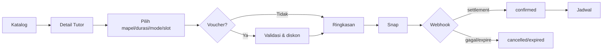
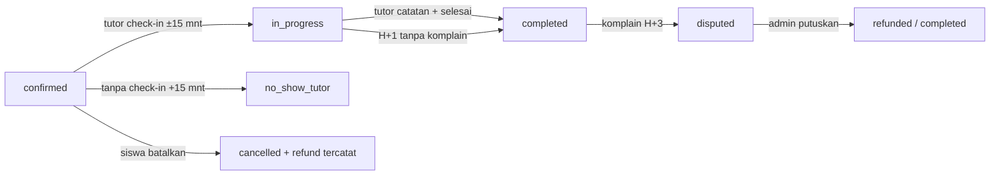
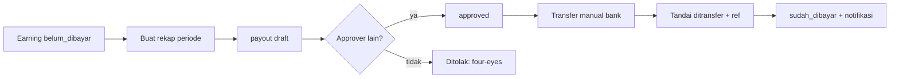

# PRD UI — Kelasxtra Bimbel

Dokumen ini adalah acuan desain UI/UX untuk seluruh fitur Kelasxtra Bimbel.
Fokus: **apa yang tampil, aksi apa yang tersedia, state apa yang harus didesain**.
Detail teknis (skema DB, RPC) ada di `docs/arsitektur.md` dan `docs/erd.md`.

- Versi: 1.0 (17 Okt 2026)
- Produk: marketplace bimbel Jogja — langganan bank soal + sesi privat & kelas grup
- Platform:
  - **Mobile siswa** (Flutter, Android/iOS)
  - **Mobile tutor** (Flutter, Android/iOS — satu codebase, flavor berbeda)
  - **Dashboard admin** (React, desktop-first, minimum 1280px)
  - **Halaman publik aktivasi tutor** (web)

---

## 1. Ringkasan Produk

Dua produk yang dijual terpisah:

1. **Langganan Bank Soal** — Rp29.000 / 30 hari, akses latihan per topik,
   tryout, pembahasan, dan analisis "Fokus Perbaikimu".
2. **Sesi Bimbel**
   - Privat: bayar per sesi (60/90/120 menit, online/offline).
   - Paket sesi: 4/8/12 sesi, diskon 0/5/10%, berlaku 90 hari, terikat 1 tutor.
   - Kelas grup: maks 5 kursi, minimal 3 siswa, bayar sekali per kursi.

Prinsip bisnis yang tampil di UI:

- Slot tutor **auto-accept** — tidak ada tombol terima/tolak untuk tutor.
- Harga dan kuota dihitung di server; UI menampilkan hasil final.
- Refund dan payroll **dicatat** di sistem, transfer uang dilakukan manual oleh admin.
- Komplain maksimal H+3 setelah sesi; auto-selesai H+1 bila tidak ada komplain.
- Reschedule maksimal 2x, maksimal 14 hari ke depan, tidak boleh ganti mode.

---

## 2. Peran & Hak Akses

| Peran | Platform | Bisa melakukan |
|---|---|---|
| Siswa | Mobile siswa | Daftar, beli langganan, latihan/tryout, pesan sesi, beli paket, ambil kursi grup, hadir, reschedule, batal, ulasan, komplain, chat |
| Tutor | Mobile tutor | Lihat jadwal, check-in, catatan sesi, selesaikan sesi, tandai no-show, reschedule, chat, absensi grup, lihat slip penghasilan |
| Admin | Dashboard | Semua modul: tutor, harga, voucher, paket, kelas grup, ruangan, bank soal, komplain, payroll, monitoring, keuangan, audit log |
| Admin role (rencana) | Dashboard | `verifikator` (tutor), `finance` (payroll/keuangan), `konten` (bank soal), `cs` (komplain) — saat ini belum dibatasi per role di UI |
| Publik | Web | Halaman aktivasi tutor lewat token undangan |

Catatan desain: tampilkan menu dashboard yang relevan per role bila role-based
navigation diaktifkan. Untuk MVP, semua admin melihat semua menu.

---

## 3. Prinsip Desain

### 3.1 Prinsip UX remaja (SMP/SMA)

- Bottom navigation maksimal 5 tab; ikon + label.
- Tap target minimal 48dp; teks body minimal 15–16sp.
- Satu aksi utama per layar; aksi sekunder memakai outline/ghost.
- Alur booking maksimal 4 langkah.
- Feedback instan: shimmer saat memuat, snackbar saat sukses/gagal.
- Dukung mode terang & gelap.
- Bahasa Indonesia santai tetapi sopan ("kamu", bukan "Anda").

### 3.2 Design token (selaras implementasi saat ini)

| Token | Nilai |
|---|---|
| Primary | `#4F46E5` (indigo) |
| Primary dark | `#4338CA` |
| Accent | `#7C3AED` (ungu) |
| Accent alt | `#06B6D4` (cyan) |
| Success | `#10B981` |
| Warning | `#F59E0B` |
| Danger | `#EF4444` |
| Info | `#3B82F6` |
| Star/rating | `#FBBF24` |
| Background terang | `#F6F7FB` |
| Surface terang | `#FFFFFF` |
| Border terang | `#E5E8EF` |
| Teks terang | `#111827` |
| Teks muted terang | `#6B7280` |
| Background gelap | `#0B1020` |
| Surface gelap | `#161C2E` |
| Border gelap | `#2A3350` |
| Teks gelap | `#F3F4F6` |
| Teks muted gelap | `#9CA3AF` |
| Gradien utama | indigo → ungu (`135°`) |
| Spacing | 4 / 8 / 12 / 16 / 24 / 32 |
| Radius | 8 / 12 / 16 / 24 |
| Font | Nunito (judul semi-bold/bold, body regular) |

Komponen dasar yang sudah ada dan harus dipakai konsisten:
`AppCard`, `AppButton` (primary/secondary/ghost + loading), `EmptyState`
(selalu punya aksi bila relevan), `AsyncView` (loading/error/retry),
`TutorCard`, `AppShell` (bottom nav).

### 3.3 Status warna

| Status | Warna | Label UI |
|---|---|---|
| `pending_payment` | warning | Menunggu bayar |
| `confirmed` | success | Terkonfirmasi |
| `in_progress` | warning | Berlangsung |
| `completed` | success | Selesai |
| `cancelled` | danger | Dibatalkan |
| `expired` | danger | Kedaluwarsa |
| `no_show_tutor` | danger | Tutor tidak hadir |
| `no_show_student` | danger | Siswa tidak hadir |
| `disputed` | info | Sengketa |
| `refunded` | danger | Dana dikembalikan |
| `rescheduled` | warning | Dijadwalkan ulang (bila dipakai) |

Status pembayaran: `pending`, `settlement/capture` (Berhasil), `deny/cancel/expire` (Gagal),
`refund/partial_refund` (Dikembalikan).

Status payroll: `draft` (Disiapkan), `approved` (Disetujui), `paid` (Sudah ditransfer).

---

## 4. Peta Layar

```
MOBILE SISWA
├── Auth
│   ├── Masuk
│   └── Daftar (siswa) — termasuk izin orang tua & kontak darurat
├── Beranda
├── Katalog
│   └── Detail Tutor
│       ├── Booking Sesi (Snap)
│       └── Beli Paket (Snap)
├── Kelas Grup
│   ├── Detail Program
│   └── Ambil Kursi (Snap)
├── Jadwal
│   └── Detail Sesi
│       ├── Saya hadir / Batalkan / Reschedule
│       ├── Ulasan / Komplain
│       └── Chat
├── Paket Saya
├── Bank Soal
│   ├── Langganan (Snap)
│   ├── Latihan per Topik
│   ├── Tryout (timer)
│   └── Hasil + Pembahasan
├── Notifikasi
└── Profil

MOBILE TUTOR
├── Auth (Masuk Tutor)
├── Beranda
├── Jadwal Mengajar
│   └── Detail Sesi
│       ├── Mulai sesi (check-in)
│       ├── Catatan sesi
│       ├── Selesaikan sesi / Tandai no-show
│       ├── Reschedule
│       └── Chat
├── Absensi Kelas Grup
├── Penghasilan (slip)
├── Notifikasi
└── Profil

DASHBOARD ADMIN
├── Masuk
├── Ringkasan
├── Tutor & Undangan
├── Price Matrix
├── Paket Sesi
├── Kelas Grup
├── Ruangan
├── CMS Bank Soal
├── Payroll
├── Monitoring
├── Keuangan
├── Voucher & Promo
├── Komplain
├── Audit Log
└── (publik) Aktivasi Tutor
```

---

## 5. Mobile Siswa — Spesifikasi Layar

### 5.1 Masuk

- **Isi**: judul, email, kata sandi, tombol Masuk, link Daftar.
- **Aksi**: masuk, lupa kata sandi (bila diaktifkan), pindah ke Daftar.
- **State**: normal, loading (spinner di tombol), error (inline di atas tombol,
  bukan alert), field kosong → validasi.
- **Catatan**: sesi tersimpan; jika sudah login langsung ke Beranda.

### 5.2 Daftar Siswa

- **Field**: nama lengkap, email, kata sandi, jenjang (SD/SMP/SMA),
  nama sekolah (opsional), nama kontak darurat, nomor kontak darurat,
  checkbox izin orang tua/wali.
- **Validasi**: email format, kata sandi minimal 8, kontak darurat wajib,
  checkbox wajib dicentang.
- **State**: loading, sukses (langsung masuk), error inline; tampilkan teks
  "Data kontak darurat hanya dipakai untuk keadaan darurat."

### 5.3 Beranda

- **Header**: sapaan "Hai, {nama} 👋", ikon notifikasi (badge unread), ikon keluar.
- **Hero card**: gradien, copy "Mau belajar apa hari ini?" + subcopy.
- **Aksi cepat** (grid 2 kolom): Cari Tutor, Jadwal, Paket Saya, Kelas Grup, Bank Soal.
- **Section "Mulai dari sini"**: kartu promo/CTA (opsional).
- **State**: shimmer saat memuat profil; tanpa data tetap tampil menu.

### 5.4 Katalog Tutor

- **Header**: "Cari Tutor", pencarian tidak wajib (filter lebih penting).
- **Filter bar** (horizontal scroll chip): Mapel, Jenjang, Mode (online/offline), Rating.
- **Kartu tutor**: avatar, nama, rating + jumlah ulasan, mapel utama, jenjang,
  harga mulai (opsional, "Mulai dari"), badge mode.
- **State**: loading shimmer (3 kartu), empty ("Tidak ada tutor yang cocok" + reset filter),
  error + Coba lagi, pull to refresh.
- **Aksi kartu**: buka Detail Tutor.

### 5.5 Detail Tutor

- **Header**: foto/avatar besar, nama, rating, bio singkat.
- **Info**: mapel & jenjang yang diajar (chip), pendidikan, mode.
- **Jadwal ketersediaan**: daftar hari + jam (bukan kalender penuh).
- **CTA sticky bawah**: "Pesan Sesi" (primary), "Beli Paket" (secondary).
- **State**: loading, error, tutor tidak ditemukan.

### 5.6 Booking Sesi (Privat)

Alur 1 layar dengan beberapa bagian (bukan wizard panjang):

1. Mapel & jenjang (pilih dari yang tersedia).
2. Durasi: 60 / 90 / 120 menit.
3. Mode: Online / Offline.
4. Tanggal & slot waktu (kalender + daftar slot).
5. Alamat lengkap (muncul hanya bila Offline; wajib).
6. Voucher (opsional): input kode → tampilkan diskon atau pesan error.
7. Ringkasan harga: harga normal, diskon, total bayar.
8. Tombol "Lanjut bayar".

- **Aturan tampil**: harga mengikuti price matrix per jenjang/durasi/mode.
  Jika belum diset admin → CTA disabled + pesan "Harga belum tersedia, hubungi admin."
- **State**: slot penuh → disabled + label "Penuh"; slot dikunci 30 menit setelah
  pembayaran dimulai (tampilkan countdown di layar pembayaran).
- **Sukses**: lanjut ke halaman Snap; setelah selesai → status di Jadwal,
  bukan halaman sukses terpisah.

### 5.7 Pembayaran (Snap WebView)

- **Isi**: judul "Selesaikan pembayaran", ringkasan singkat (sesi, jadwal, total),
  WebView Midtrans, tombol "Cek status" / "Tutup".
- **State**: loading, gagal memuat (Coba lagi), pembayaran tertunda (status pending),
  sukses → langsung ke Jadwal dengan highlight sesi baru.
- **Penting**: jangan tampilkan bagi hasil tutor di layar mana pun.

### 5.8 Jadwal (daftar sesi)

- **Kartu sesi**: nama tutor, status chip, mapel · jenjang · durasi,
  mode (ikon), tanggal & jam (WIB), harga.
- **Urutan**: terbaru di atas.
- **State**: loading, kosong ("Belum ada sesi" + CTA Cari Tutor), error, pull refresh.
- **Aksi**: tap kartu → Detail Sesi.

### 5.9 Detail Sesi (siswa)

- **Ringkasan**: tutor, status, mapel/jenjang/durasi/mode, jadwal, alamat (bila sudah bayar),
  harga, refund tercatat (bila ada).
- **Aksi berdasarkan status/peran**:
  - `in_progress` & belum hadir → **"Saya hadir"**.
  - `confirmed` → **Ajukan reschedule**, **Batalkan sesi** (dengan dialog alasan &
    info refund: >24 jam penuh, <24 jam 50%).
  - `confirmed` dan lewat 15 menit → **Tutor tidak hadir**.
  - `completed` → **Beri ulasan** (bintang 1–5 + komentar opsional),
    **Ajukan komplain** (kategori + isi).
  - `disputed` → **Ajukan komplain** (lihat status komplain).
- **Chat**: daftar pesan (kiri/kanan), input + kirim, refresh, notice
  "Nomor telepon disamarkan" pada pesan yang difilter.
- **State**: aksi dinonaktifkan dengan alasan singkat (mis. "Ulasan sudah dikirim",
  "Batas komplain H+3 lewat").

### 5.10 Paket Sesi

**Beli Paket**

- Pilih 4/8/12 sesi; tampilkan diskon 0/5/10%, harga per sesi, total, masa berlaku 90 hari.
- Info: terikat 1 tutor & mapel/jenjang/durasi/mode yang sama.
- Tombol "Beli paket" → Snap.
- State: loading harga, error, pembayaran pending.

**Paket Saya**

- Kartu paket: tutor, mapel/jenjang/durasi/mode, sisa kuota (`x/y`), progress bar,
  berlaku sampai, status.
- Aksi: "Pesan sesi" (langsung ke booking dengan kuota), "Lihat tutor".
- Empty state + CTA Cari Tutor.

### 5.11 Kelas Grup

**Daftar program**

- Kartu: mapel, jenjang, tutor, jadwal pertama–terakhir, harga per sesi & total,
  keterisian (`3/5 kursi`), deadline konfirmasi, status.
- Filter: mapel/jenjang (opsional).
- Badge: "Hampir penuh", "Dibuka", "Terkonfirmasi".

**Detail program**

- Info lengkap + daftar 8 pertemuan (tanggal & jam).
- Aturan: min 3 siswa, maks 5; bila kurang → program batal & refund.
- CTA "Ambil kursi" → Snap. Bila penuh/deadline lewat → disabled + alasan.

### 5.12 Bank Soal

**Layar utama**

- Kartu status langganan: aktif s/d tanggal / tenggang / tidak aktif + CTA perpanjang.
- CTA besar **Tryout** (20 soal, 20 menit, dinilai otomatis) — terkunci bila langganan
  tidak aktif.
- **Latihan per topik**: daftar topik + mapel + jenjang + jumlah soal.
- **Fokus Perbaikimu**: topik akurasi terendah, tren naik/turun.
- State: loading, belum langganan (overlay CTA), kosong.

**Latihan**

- Satu soal per layar: progress "Soal 3 dari 10", body (mendukung rumus & gambar),
  opsi A–D, tombol Sebelumnya / Lanjut / Selesai & nilai.
- **Tryout**: timer mm:ss di header, auto-submit saat habis, tidak bisa keluar tanpa konfirmasi.
- State: loading soal, error dengan Coba lagi, jawaban boleh kosong (dihitung salah).

**Hasil**

- Skor besar, "x benar dari y soal", daftar pembahasan per soal (benar/salah,
  kunci, pembahasan), tombol ulangi/kembali.
- State: hasil dimuat sekali, tidak bisa submit ulang.

### 5.13 Notifikasi

- Daftar kartu: judul, isi, waktu, titik biru bila belum dibaca.
- Tap → tandai dibaca (tetap di layar).
- Empty state: "Belum ada notifikasi".
- Jenis: booking, sesi, ulasan, reschedule, komplain, payroll, langganan.

### 5.14 Profil

- Data akun: nama, email, telepon.
- Data siswa: jenjang, sekolah, kontak darurat.
- Status langganan bank soal.
- Tombol Keluar.
- (Opsional) edit profil, ganti kata sandi.

---

## 6. Mobile Tutor — Spesifikasi Layar

### 6.1 Masuk Tutor

- Sama seperti login siswa, judul "Masuk Tutor".
- Bila akun bukan tutor → Beranda menampilkan kartu **"Akun ini bukan tutor"** +
  tombol Keluar. Tidak boleh masuk ke fitur tutor.

### 6.2 Beranda Tutor

- Sapaan, hero "Siap mengajar hari ini?".
- Aksi cepat: Profil Saya, Jadwal Mengajar, Absensi Grup, Penghasilan.
- Ikon notifikasi + keluar.
- Badge ringkas (opsional): sesi hari ini, sesi berlangsung.

### 6.3 Jadwal Mengajar

- Daftar sesi milik tutor (bukan sesi sebagai siswa).
- Kartu: nama siswa, status, mapel/jenjang/durasi, jadwal, mode.
- Tap → Detail Sesi Tutor.

### 6.4 Detail Sesi Tutor

- Ringkasan sama seperti siswa (tanpa harga siswa; tampilkan honor? **jangan** —
  honor dilihat di slip).
- Aksi per status:
  - `confirmed` → **Mulai sesi** (offline: minta izin lokasi + cek radius 200 m;
    di luar radius tampilkan pesan jelas), **Ajukan reschedule**,
    **Tandai siswa tidak hadir** (setelah jam mulai).
  - `in_progress` → **Catatan sesi** (materi wajib, progres opsional),
    **Selesaikan sesi** (wajib catatan), **Tandai siswa tidak hadir**.
  - Status lain → hanya chat/riwayat.
- Chat sama seperti siswa.
- State: loading, error, tombol disabled + alasan, snackbar sukses/gagal.

### 6.5 Absensi Kelas Grup

- Daftar pertemuan (dikelompokkan per sesi): mapel · jenjang · mode,
  "Pertemuan 3 · 24 Okt 16:00".
- Per siswa: nama + segmented control **Hadir / Izin / Alpa**.
- State: belum ada kelas, loading, error, penyimpanan per siswa (optimistic + snackbar).
- Catatan: hanya kelas milik tutor yang tampil.

### 6.6 Penghasilan (Slip)

- Kartu per periode payroll: rentang tanggal, nominal, status
  (Disiapkan / Disetujui / Sudah ditransfer), bank, referensi transfer.
- **Tanpa tombol tarik dana** — beri keterangan "Transfer dilakukan admin ke rekeningmu."
- Empty state: "Slip muncul setelah admin membuat rekap payroll."
- (Opsional) rincian per sesi bila admin menyediakan.

### 6.7 Profil Tutor

- Nama, email, telepon, bio/pendidikan (read-only untuk MVP).
- Data bank **tidak ditampilkan di mobile** (hanya admin).
- Tombol keluar.

---

## 7. Dashboard Admin — Spesifikasi Modul

Layout umum: sidebar kiri (nama modul + fase), header kanan (email admin + Keluar),
konten tabel/kartu. Semua tabel: header jelas, aksi kanan, empty state, loading teks,
notice line untuk hasil aksi. Konfirmasi destruktif wajib.

### 7.1 Ringkasan

- Grid kartu modul dengan nama, deskripsi, badge fase.

### 7.2 Tutor & Undangan

- Form buat akun tutor (nama, email) → menghasilkan link undangan (salin).
- Tabel tutor: nama, email, status (Diundang/Aktif/Suspend), aksi
  (salin link, suspend/reaktivasi).
- Info: link berlaku 7 hari; pengiriman email manual (WhatsApp).

### 7.3 Price Matrix

- Tabel harga per jenjang × durasi × mode × tipe (privat/grup).
- Edit inline + tampilkan riwayat perubahan (harga lama → baru, siapa, kapan).
- Konfirmasi sebelum simpan; harga baru hanya untuk transaksi baru.

### 7.4 Paket Sesi

- Tabel pembelian: siswa, tutor, mapel/jenjang, sisa kuota, total bayar,
  berlaku sampai, status.
- Aksi: **Refund** proporsional (hitung & catat; dana manual via Midtrans),
  **Pindah tutor** (pilih tutor aktif, konfirmasi persetujuan siswa, alasan).

### 7.5 Kelas Grup

- Form buat program: tutor, mapel, jenjang, mode, ruangan (offline), durasi,
  jumlah sesi, hari & jam mulai, harga per sesi.
- Pantau keterisian & status; aksi refund kursi.
- Validasi bentrok ruangan ditampilkan sebagai error form.

### 7.6 Ruangan

- Form: nama, alamat, latitude, longitude (opsional).
- Tabel: nama, alamat, koordinat, status aktif, tombol Ubah koordinat.
- Catatan UI: koordinat dipakai untuk geofence offline.

### 7.7 CMS Bank Soal

- Form soal: mapel, topik, jenjang, tipe (PG/isian), body (mendukung KaTeX `$...$`),
  opsi A–D, kunci, pembahasan, gambar (upload).
- Alur status: draft → review → published → archived.
- Daftar soal dengan filter mapel/jenjang/status; aksi ubah status, edit (versi baru),
  lihat riwayat versi.
- Preview soal seperti tampilan siswa.

### 7.8 Payroll

- Input rentang tanggal (default 26 bulan lalu – 25 bulan ini, WIB).
- Tombol **Buat rekap** → notice: jumlah tutor, sesi, total.
- Tabel periode: periode, status, disetujui, dibayar, aksi.
- Aksi: **Setujui** (four-eyes: approver ≠ pembuat; tampilkan error jelas),
  **Batalkan** (draft), **Tandai ditransfer** (wajib referensi bank).
- Detail payout: tutor, bank, nomor, pemilik, nominal, status, referensi;
  tombol **Ekspor CSV**.
- Peringatan: "Transfer dilakukan manual lewat bank."

### 7.9 Monitoring

- Filter tanggal.
- Kartu: Sesi (total/selesai/no-show/batal/hari ini), Operasional
  (berlangsung, menunggu bayar, grup dibuka, komplain terbuka), Pengguna
  (siswa, tutor aktif, langganan aktif), Honor (belum/sudah dibayar).
- Tabel **Performa Tutor**: rating, selesai, batal, no-show, honor tertahan.
- Tabel **Progres Siswa**: jenjang, sesi selesai, latihan bank soal.
- Tabel **Koreksi Absensi** (10 sesi terbaru): tombol Koreksi → pilih status baru +
  alasan (wajib) → konfirmasi. Error bila earning sudah masuk payroll.

### 7.10 Keuangan

- Filter tanggal.
- Kartu: Gross settlement, Biaya gateway, Potongan platform 25%,
  Honor tutor (belum dibayar), Refund tercatat.
- Tabel transaksi terbaru: order, tipe, nominal, gateway fee, status, tanggal bayar.
- Tabel ledger honor: tanggal sesi, tutor, sumber (Privat/Kelas grup),
  honor tutor, platform, status.

### 7.11 Voucher & Promo

- Form: kode, tipe diskon (persen/nominal), nilai, minimum pembelian,
  kuota, tanggal kedaluwarsa.
- Tabel: kode, diskon, kuota, terpakai, status aktif, aksi (aktif/nonaktif, hapus).
- **Laporan pemakaian**: terpakai, dikunci (belum bayar), total diskon, kuota.

### 7.12 Komplain

- Filter status: Baru, Ditinjau, Selesai, Ditolak, Semua.
- Tabel: tanggal, siswa, tutor, kategori, isi, status, refund, aksi.
- Aksi: **Selesaikan** (keputusan + nominal refund 0..harga transaksi),
  **Tolak** (alasan). Dana tetap manual.
- Info: selama komplain terbuka, honor tutor ditahan.

### 7.13 Audit Log

- Filter aksi (mis. `payroll`, `booking.correct`).
- Tabel 200 terakhir: waktu, aktor, aksi, entitas, ID, data sebelum/sesudah.
- Read-only.

### 7.14 Aktivasi Tutor (publik)

- Halaman dari link undangan: form kata sandi baru, profil (bio/pendidikan/foto),
  data bank (nama bank, nomor, pemilik).
- State: token valid/kedaluwarsa, sukses → "Akun aktif, silakan masuk aplikasi tutor."
- Tanpa login; token di URL.

---

## 8. Alur Utama

### 8.1 Booking privat



### 8.2 Sesi & komplain



### 8.3 Payroll



---

## 9. Pola State Wajib

Untuk setiap layar, desainer wajib menyiapkan:

1. **Loading** — shimmer untuk daftar/kartu; spinner untuk aksi tombol.
2. **Empty** — ilustrasi/ikon ringan + 1 kalimat + aksi (bila ada).
3. **Error** — judul singkat, pesan ramah, tombol **Coba lagi**. Jangan tampilkan
   stack trace/istilah teknis ke pengguna.
4. **Success** — snackbar singkat atau perubahan status langsung.
5. **Disabled** — alasan terlihat (mis. "Menunggu konfirmasi admin").
6. **Offline** — banner "Tidak ada koneksi" + aksi coba lagi.

Contoh copy error:
- "Gagal memuat jadwal. Periksa koneksimu lalu coba lagi."
- "Slot ini baru saja diambil orang lain. Pilih slot lain, ya."
- "Batas komplain H+3 sudah lewat."

---

## 10. Responsif & Aksesibilitas

- **Mobile**: target 360–430dp lebar; aman untuk notch; keyboard tidak menutupi CTA
  (gunakan scroll + padding bawah).
- **Dashboard**: minimum 1280px; tabel boleh horizontal scroll di layar kecil;
  sidebar tetap; modal konfirmasi untuk aksi uang.
- Kontras teks minimal WCAG AA (4.5:1 untuk body).
- Jangan hanya mengandalkan warna untuk status — selalu ada label teks.
- Semua ikon aksi punya tooltip/label.
- Dukung font scaling: layout tidak terpotong pada 120%.
- Form: label di atas field, error di bawah field, bukan placeholder-only.

---

## 11. Konten & Nada Bahasa

- Sapa pengguna dengan "kamu"; hindari "Anda" dan istilah teknis.
- Hindari janji berlebihan ("tutor terbaik") — gunakan faktual.
- Uang selalu format `Rp75.000` (tanpa desimal).
- Waktu selalu WIB, format "Sab, 17 Okt · 17:00".
- Status memakai label manusiawi (lihat tabel status).
- Tombol memakai kata kerja: "Pesan sesi", "Ambil kursi", "Tandai ditransfer".

---

## 12. Batasan yang Perlu Diketahui Desainer

- **FCM push belum aktif** — layar notifikasi tetap ada, tetapi belum ada push real-time.
- **Geofence offline**: titik lokasi booking privat belum diisi dari UI; untuk sementara
  check-in offline tidak menolak jarak bila titik acuan kosong. Desain tetap siapkan
  state "Di luar radius 200 m".
- **Tarif gateway**: hanya estimasi dari webhook; tidak memotong honor tutor.
- **Role admin** belum membatasi menu; siapkan varian tampilan bila nanti dibatasi.
- **Pembayaran**: Snap adalah WebView pihak ketiga; jangan mendesain ulang halaman Midtrans.
- **Tidak ada dompet tutor / tombol tarik dana** — jangan mendesainnya.

---

## 13. Handoff untuk Desainer

Deliverable yang diminta:

1. **Design system**: warna (light/dark), tipografi, spacing, radius, tombol
   (primary/secondary/ghost/disabled/loading), input, chip, badge status,
   card, tabel, modal, snackbar, empty state, skeleton.
2. **Mobile siswa**: 16 layar inti + state loading/empty/error.
3. **Mobile tutor**: 7 layar inti + state.
4. **Dashboard**: 13 modul + modal konfirmasi (refund, payroll, koreksi, transfer).
5. **Prototype** alur: booking → bayar → jadwal; latihan → hasil; check-in → catatan →
   selesai; komplain → resolusi; payroll.
6. **Spesifikasi komponen** (ukuran, padding, state) dalam Figma.
7. **Ekspor aset**: ikon status, ilustrasi empty state, logo.

Urutan prioritas desain:

1. Mobile siswa: Beranda, Katalog, Booking, Jadwal/Detail Sesi.
2. Bank soal: langganan, latihan, hasil.
3. Mobile tutor: jadwal, detail sesi, absensi grup, slip.
4. Dashboard: monitoring, payroll, komplain.
5. Sisanya (CMS, price matrix, voucher, audit).

---

## 14. Referensi Dokumen

- `docs/brief-implementasi-v2.0.md` — aturan bisnis lengkap.
- `docs/arsitektur.md` — state machine booking, pembayaran, payroll.
- `docs/erd.md` — model data.
- `docs/PROGRES.md` — status implementasi per fase.
- `catatan/2026-10-16-ui-fondasi-desain.md` — fondasi tema & library.
